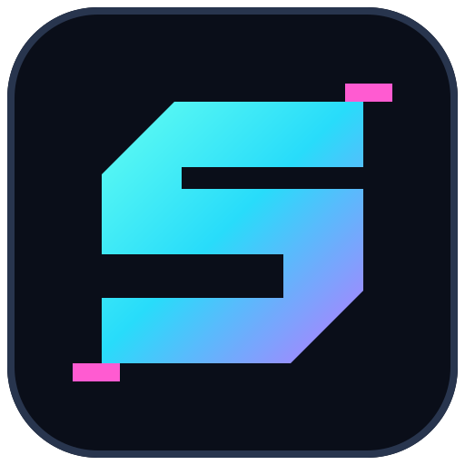

# STRETCH

**Less noise. Same signal.**

Chrome extension. Compress page prose in place. Keep the site’s design. Expand exact originals on demand.

```text
[click toolbar]  → compress
[select + right click] → Stretch selection
[click text]     → expand original
[Collapse]       → shrink again
[click toolbar]  → restore / cancel
```

## > boot

```sh
npm ci
npm run build
```

1. `chrome://extensions` → **Developer mode** → **Load unpacked** → `dist/`.
2. **Extension options** → provider → API key → model → acknowledge page-text processing → **Save settings**.
3. Open an article. Hit Stretch.

**Providers:** Anthropic · OpenAI · OpenRouter. Haiku 5.5 is the default for new Anthropic/OpenRouter profiles. Existing choices stay put. Refresh the model list or enter an ID; the model must support structured output.

Anthropic multi-workspace key? Add your `wrkspc_…` ID from [Console → Workspaces](https://platform.claude.com/settings/workspaces).

## > trust boundary

- No backend. Page text leaves your browser **only after activation**, to your selected provider.
- Keys stay in trusted local extension storage—not encrypted, not synced, not exposed to pages.
- API credits required. **Test connection** is billable; bounded truncation retries can cost extra. No subscription login or silent provider/model switching.
- Original nodes stay local. Model output is text, never executable HTML.
- Summaries can miss nuance. Expand and verify. Don’t send sensitive pages without reviewing your provider’s data policy.

## > known edges

Prose only. Code, tables, controls, media, and hidden content are skipped. No Chrome internal pages, PDFs, canvas, or iframe/shadow-root traversal. Dynamic sites may resist modification.

## > verify

```sh
npm test
npx tsc --noEmit
npx playwright install chromium  # once; or set CHROMIUM_PATH
npm run test:browser
npm run build                   # restore production bundle after browser tests
npm run release                 # production ZIP + SHA-256 in releases/
```

Demo screenshots and the capture fixture live in [`store/`](store/). Chrome Web Store submission is still pending; API credits and a compatible model are required.

## > project

[MIT](LICENSE). By **soupdiver**.

Website source: [`docs/`](docs/). `npm run site` refreshes the shared privacy notice and artwork locally. Planned home: `https://soupdiver.github.io/stretch/`. **Nothing is published automatically.**

Tests mock provider APIs. No live inference guarantee. SVG source and PNG icons live in `assets/`; regenerate with `CHROMIUM_PATH=/usr/bin/chromium node scripts/render-icons.mjs` or an installed Playwright Chromium.
